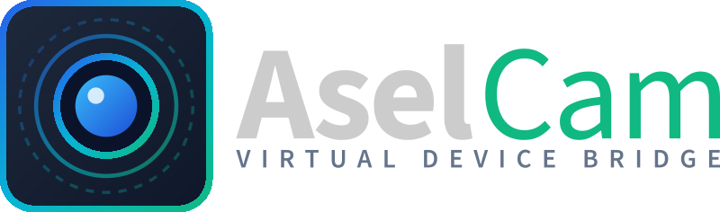

<p align="center">
  
</p>

> **Ultra Low-Latency Virtual Camera & Microphone Studio**  
> *Turn your Android phone or Apple iPhone into a studio-grade 4K 60 FPS webcam and virtual microphone for Linux, Windows, and macOS.*

[](LICENSE)
[](#platform-support-matrix)
[](https://www.python.org/)
[](https://kotlinlang.org/)
[](https://swift.org/)
[](#architecture--latency)
[](#)
[](https://buymeacoffee.com/aselens)

---

## 📑 Table of Contents

- [Overview](#overview)
- [Key Features](#key-features)
- [Architecture & Latency](#architecture--latency)
- [Platform Support Matrix](#platform-support-matrix)
- [Quick Start Guide](#quick-start-guide)
  - [1. Mobile App Setup (Android / iOS)](#1-mobile-app-setup-android--ios)
  - [2. Desktop Studio Setup (Linux / Windows / macOS)](#2-desktop-studio-setup-linux--windows--macos)
- [Neumorphic Studio UI](#neumorphic-studio-ui)
- [RAW Sensor & Color Science](#raw-sensor--color-science)
- [AI Portrait Bokeh & Background Isolation](#ai-portrait-bokeh--background-isolation)
- [Hardware Zoom (Up to 100x)](#hardware-zoom-up-to-100x)
- [Mobile Screen Mirroring](#mobile-screen-mirroring)
- [Internationalization (i18n)](#internationalization-i18n)
- [Binary Wire Protocol Specification](#binary-wire-protocol-specification)
- [Building from Source](#building-from-source)
- [Testing & Quality Assurance](#testing--quality-assurance)
- [Support the Project](#-support-the-project)
- [License](#license)

---

## 🚀 Overview

**AselCam** transforms modern smartphones into ultra low-latency, broadcast-quality virtual webcams and microphones for your computer. Unlike traditional webcam utilities, AselCam runs **100% locally and peer-to-peer** without intermediate cloud relays, proprietary drivers, or subscription paywalls.

Whether connecting over high-speed USB (ADB / Lightning / USB-C) or local Wi-Fi, AselCam delivers uncompressed raw or hardware-encoded H.264/HEVC video with sub-10ms glass-to-glass latency, direct V4L2 loopback and DirectShow/CoreMedia compatibility, and full studio color grading.

---

## ✨ Key Features

- **⚡ Sub-10ms Glass-to-Glass Latency**: Zero-copy pipeline with hardware-accelerated encoding (`MediaCodec` on Android, `VideoToolbox` on iOS) and FFmpeg / hardware-accelerated decoding.
- **🖥️ True Cross-Platform Desktop**:
  - **Linux**: Kernel-level V4L2 loopback (`/dev/video10`) + PipeWire / PulseAudio virtual microphone sink (`module-null-sink` & `module-remap-source`).
  - **Windows**: DirectShow & OBS Virtual Camera integration via `pyvirtualcam`.
  - **macOS**: CoreMedia virtual camera backend.
- **📱 Native Mobile Clients**:
  - **Android**: Modern Kotlin 2.0 app with Camera2 / CameraX NDK, hardware encoder, and foreground streaming service.
  - **iOS**: Pure Swift / SwiftUI app with AVFoundation, VideoToolbox, and ReplayKit screen capture.
- **🔍 100x Hardware & Optical Zoom**: Direct control over the smartphone's physical multi-lens array (Wide, Ultra-Wide, Telephoto, Periscope) rather than blurry digital crops.
- **🎨 RAW Sensor & Color Grading**: 1D RGB LUTs with 0 ms identity fast-path, exposure EV (+/-3.0), highlight/shadow recovery, whites/blacks balance, Kelvin temperature/tint white balance, and film S-curve profiles.
- **🤖 AI Neural Portrait Isolation**: Background blur (bokeh), studio spotlight, and custom virtual background replacement using MediaPipe selfie segmentation.
- **📱 Real-Time Screen Mirroring**: Instantly cast your mobile phone display to the virtual camera with audio pass-through.
- **🔋 AMOLED True Blackout**: Turns off phone display pixels entirely while keeping sensor and hardware encoder running at full 60 FPS, eliminating heat and preserving battery.
- **🌐 8-Language Localization**: Automatic system locale detection with runtime language switching for English, Turkish, German, French, Spanish, Russian, Japanese, and Arabic.

---

## ⚡ Architecture & Latency

```
+--------------------------------------------------------------------------+
|                              MOBILE SENDER                               |
|                                                                          |
|  [ Camera2 / AVFoundation ]  OR  [ Screen Capture (ReplayKit/MediaProj) ] |
|                             |                                            |
|                  [ Hardware Encoder ]                                    |
|               (MediaCodec / VideoToolbox)                                |
|                             |                                            |
|              [ TCP 4747 Streaming Server ]                               |
|        (18-byte ASEL Binary Protocol Header + SPS/PPS IDR)               |
+--------------------------------------------------------------------------+
                                  |
                   [ USB (ADB) or Local Wi-Fi ]
                                  |
+--------------------------------------------------------------------------+
|                             DESKTOP RECEIVER                             |
|                                                                          |
|                       [ StreamReceiver ]                                 |
|            (FFmpeg H.264 Decoder + Frame Queue Sync)                     |
|                             |                                            |
|            +----------------+----------------+                           |
|            |                                 |                           |
|     [ VideoFilters ]                  [ AudioSink ]                      |
|  - 0 ms Identity Fast-Path        - PipeWire / PulseAudio                |
|  - 1D RGB Tone LUTs               - Virtual Mic (24 kHz PCM)             |
|  - AI Portrait Bokeh / Seg.       - Real-time VU RMS Meter               |
|  - Laplacian Sharpness                       |                           |
|            |                                                             |
|   [ VirtualCamSink ]                                                     |
|  - Linux: /dev/video10 (V4L2)                                            |
|  - Windows/macOS: pyvirtualcam                                           |
|            |                                                             |
|   [ Video Conferencing / Streaming Apps (Zoom, OBS, Discord, Teams) ]    |
+--------------------------------------------------------------------------+
```

---

## 📊 Platform Support Matrix

| OS | Virtual Video Output | Virtual Audio Sink | Connection Modes | Hardware Acceleration |
| :--- | :--- | :--- | :--- | :--- |
| **Linux** (Ubuntu, Arch, Fedora, Debian) | Native V4L2 Loopback (`/dev/video10`) | PipeWire & PulseAudio Null-Sink | USB (ADB) & Wi-Fi | VA-API / VDPAU / CUDA |
| **Windows** (10, 11) | DirectShow / OBS Virtual Cam | Virtual Audio Cable / Direct | USB (ADB) & Wi-Fi | NVDEC / D3D11VA / QSV |
| **macOS** (12+ Monterey, Ventura, Sonoma) | CoreMedia Virtual Camera | BlackHole / Loopback | USB & Wi-Fi | VideoToolbox / Metal |
| **Android** (8.0+ Oreo to 15+) | N/A (Sender) | Built-in Mic / Headset | USB & Wi-Fi | MediaCodec (H.264 / HEVC) |
| **iOS** (15.0+ iPhone & iPad) | N/A (Sender) | Built-in Mic / Headset | USB & Wi-Fi | VideoToolbox (H.264) |

---

## 🚀 Quick Start Guide

### 1. Mobile App Setup (Android / iOS)

#### Android:
- **Direct APK**: Download and install the pre-compiled [`AselCam.apk`](AselCam.apk) directly on your Android phone.
- **From Source**:
  ```bash
  cd android
  ./gradlew assembleDebug
  adb install -r app/build/outputs/apk/debug/app-debug.apk
  ```

#### iOS:
- Open `ios/AselCam.xcodeproj` in Xcode.
- Select your Development Team under **Signing & Capabilities**.
- Press **Run (`⌘R`)** to deploy to your iPhone or iPad.

---

### 2. Desktop Studio Setup (Linux / Windows / macOS)

#### Linux (Ubuntu / Debian / Arch / Fedora):
1. **Configure virtual camera permissions**:
   ```bash
   ./scripts/setup_system.sh
   ```
2. **Launch AselCam Studio**:
   ```bash
   ./run_desktop.sh
   ```

#### Windows:
1. Ensure Python 3.10+ is installed and in your `PATH`.
2. Double-click `desktop/run_windows.bat` or run:
   ```cmd
   cd desktop
   pip install -r requirements.txt
   python -m aselcam.main
   ```

#### macOS:
1. Ensure Python 3.10+ is installed (`brew install python`).
2. Run:
   ```bash
   cd desktop
   ./run_macos.sh
   ```

---

## 🎛️ Neumorphic Studio UI

AselCam features an Obsidian Dark Neumorphic studio interface:
- **Clean Inset HUD**: Displays live device metrics (Device Model, Battery %, Ping, Live FPS, Stream Bitrate, and Audio RMS meter).
- **Responsive Layout**: Resizable studio interface tailored for both high-DPI desktop monitors and mobile touch controls.
- **Zero-Flicker Viewfinder**: Real-time monitor view with an instant toggle to disable the preview and drop CPU/GPU usage to near 0%.

---

## 🎨 RAW Sensor & Color Science

AselCam provides complete control over your smartphone's image output:

- **0 ms Fast Path**: When filters are neutral, frames pass directly to the virtual camera sink without memory copies or arithmetic overhead.
- **1D RGB Tone LUTs**:
  - Exposure Compensation (`-3.0 EV` to `+3.0 EV`)
  - Highlight and Shadow detail recovery
  - Blacks and Whites clipping threshold
  - Contrast and Brightness curve shaping
- **White Balance**:
  - Temperature (Cool Blue `<-0->` Warm Amber)
  - Tint (Green `<-0->` Magenta)
- **RGB Gain Balance**: Independent Red, Green, and Blue channel gain calibration.
- **Studio Presets**: Standard (Natural), Vivid Stream, Cinematic Warm, Studio Portrait, Low Light / Night, Retro Film, and Monochrome B&W.
- **True Laplacian Edge Sharpening**: High-frequency edge accentuation that avoids highlight blowout on flat surfaces.

---

## 🤖 AI Portrait Bokeh & Background Isolation

Powered by on-device neural selfie segmentation:
- **Bokeh Lens Blur**: Natural depth-of-field effect with adjustable blur intensity and edge feathering.
- **Studio Spotlight**: Subtly dims background lighting while keeping the speaker illuminated.
- **Custom Virtual Background**: Replace your background with any image file (`.png`, `.jpg`, `.webp`) without requiring a green screen.

---

## 🔍 Hardware Zoom (Up to 100x)

Unlike standard webcams that digitally crop and pixelate, AselCam commands the phone's physical camera subsystem:
- Switch seamlessly between physical lenses (Ultra-Wide, Wide, 3x Telephoto, 10x Periscope).
- Hardware zoom magnification up to **100x Space Zoom** (e.g. Samsung Galaxy S25 Ultra / S24 Ultra).
- 1-click preset jumps: `1x`, `3x`, `10x`, `100x`.

---

## 📱 Mobile Screen Mirroring

Cast your phone screen directly into video conferences, livestreams, or recordings:
- One-click toggle from camera to display mirroring.
- Supports native portrait and landscape auto-rotation.
- Real-time mobile audio streaming alongside screen video.

---

## 🌐 Internationalization (i18n)

AselCam includes automatic operating system language detection with full dictionary translations for 8 languages:
- 🇬🇧 **English** (`en`)
- 🇹🇷 **Türkçe** (`tr`)
- 🇩🇪 **Deutsch** (`de`)
- 🇫🇷 **Français** (`fr`)
- 🇪🇸 **Español** (`es`)
- 🇷🇺 **Русский** (`ru`)
- 🇯🇵 **日本語** (`ja`)
- 🇸🇦 **العربية** (`ar`)

You can override the language anytime via the interactive titlebar dropdown selector (`🇬🇧 EN`, `🇹🇷 TR`, `🇩🇪 DE`, `🇫🇷 FR`, `🇪🇸 ES`, `🇷🇺 RU`, `🇯🇵 JA`, `🇸🇦 AR`). Changes persist across sessions in `config.json`.

---

## 📡 Binary Wire Protocol Specification

AselCam uses an ultra-compact binary protocol designed for zero-latency frame transmission over TCP port **4747**:

```
 0                   1                   2                   3
 0 1 2 3 4 5 6 7 8 9 0 1 2 3 4 5 6 7 8 9 0 1 2 3 4 5 6 7 8 9 0 1
+-+-+-+-+-+-+-+-+-+-+-+-+-+-+-+-+-+-+-+-+-+-+-+-+-+-+-+-+-+-+-+-+
|                       Magic: "ASEL"                           |
+-+-+-+-+-+-+-+-+-+-+-+-+-+-+-+-+-+-+-+-+-+-+-+-+-+-+-+-+-+-+-+-+
|     Type      |     Flags     |      Timestamp (µs, high)     |
+-+-+-+-+-+-+-+-+-+-+-+-+-+-+-+-+-+-+-+-+-+-+-+-+-+-+-+-+-+-+-+-+
|                      Timestamp (µs, low)                      |
+-+-+-+-+-+-+-+-+-+-+-+-+-+-+-+-+-+-+-+-+-+-+-+-+-+-+-+-+-+-+-+-+
|                        Payload Length                         |
+-+-+-+-+-+-+-+-+-+-+-+-+-+-+-+-+-+-+-+-+-+-+-+-+-+-+-+-+-+-+-+-+
|                        Payload Bytes...                       |
+-+-+-+-+-+-+-+-+-+-+-+-+-+-+-+-+-+-+-+-+-+-+-+-+-+-+-+-+-+-+-+-+
```

### Packet Types:
- `0x01`: `TYPE_VIDEO_H264` - Annex-B formatted H.264 NAL units
- `0x02`: `TYPE_VIDEO_H265` - Annex-B formatted HEVC NAL units
- `0x03`: `TYPE_AUDIO_PCM` - 24,000 Hz, 16-bit Mono Linear PCM
- `0x04`: `TYPE_CODEC_CONFIG` - SPS/PPS Parameter Sets for immediate decoding

### Control Port (TCP 4748):
Bi-directional JSON messages exchange device telemetry and control commands:
```json
// Command
{"cmd": "set_zoom", "zoom": 3.0}

// Response
{"reply_to": "set_zoom", "status": "ok"}
```

---

## 🔨 Building from Source

### Android Build:
```bash
./build_all.sh
```

### Windows Executable (`AselCam.exe`):
```cmd
cd desktop
build_windows_exe.bat
```

### macOS Application (`AselCam.app`):
```bash
cd desktop
./build_macos_app.sh
```

---

## 🧪 Testing & Quality Assurance

AselCam includes a comprehensive unit and integration test suite covering pipeline end-to-end telemetry, RAW LUT calibration, V4L2 virtual sinks, PipeWire virtual microphones, AI background segmentation, and multi-language retranslation:

```bash
PYTHONPATH=desktop python3 -m unittest discover -s desktop/tests -v
```

All 18 test suites pass with zero regressions.

---

## ☕ Support the Project

If AselCam makes your meetings, streams, or workflows better, consider supporting ongoing development:

<p align="center">
  <a href="https://www.buymeacoffee.com/aselens" target="_blank">
    
  </a>
</p>

---

## 📄 License

This project is licensed under the **MIT License** - see the [LICENSE](LICENSE) file for details.

---

Developed by [Aselens Software](https://aselens.com) 
